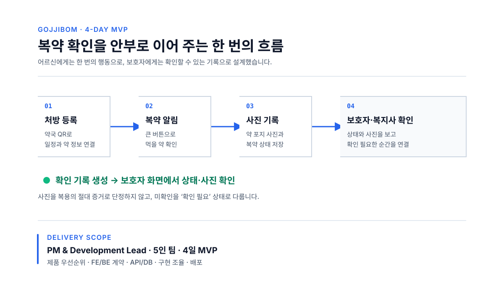
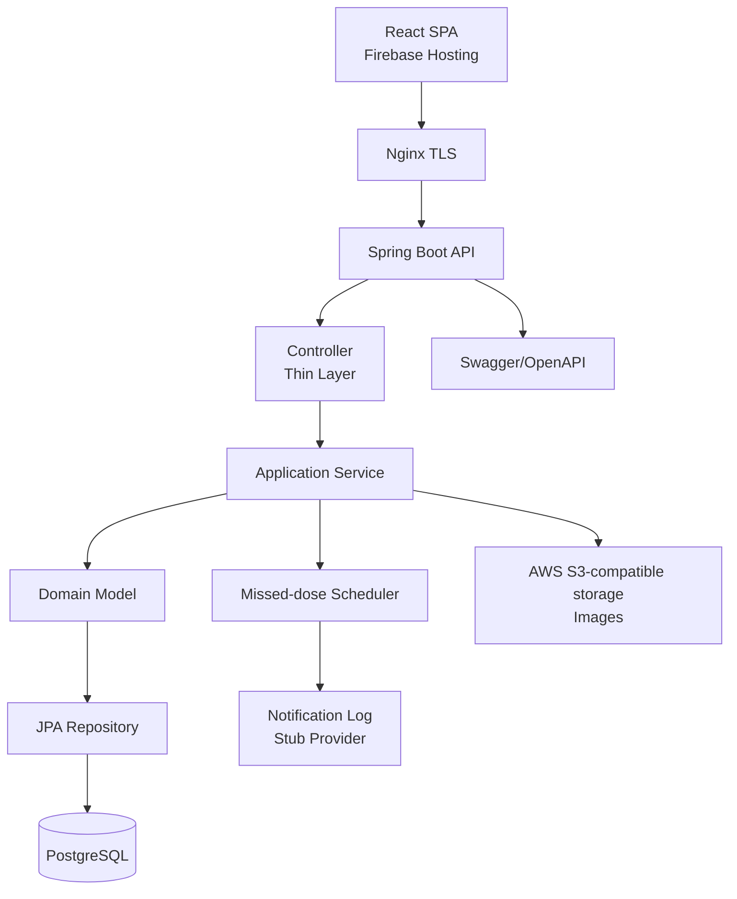
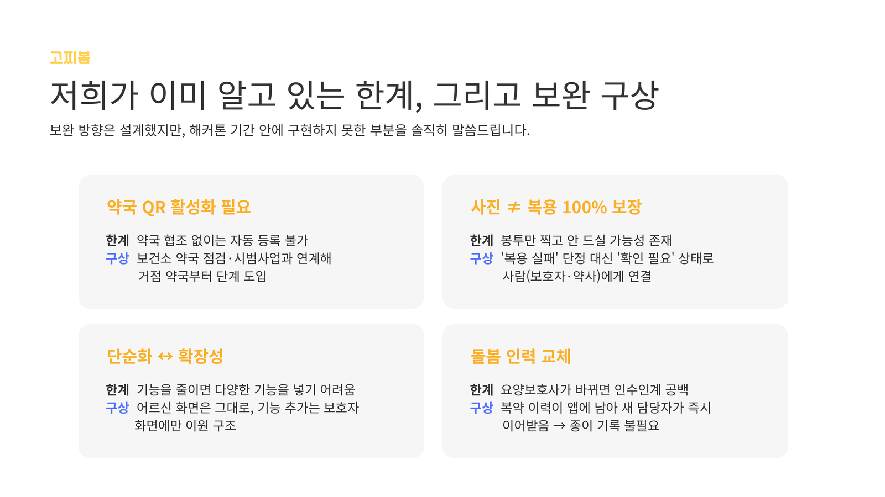

<div align="center">

# 고찌봄 Backend

### 약 먹는 순간이, 곧 안부가 되는 복약 안부 API


[](https://kotlinlang.org/)
[](https://spring.io/projects/spring-boot)
[](https://www.postgresql.org/)
[](https://www.docker.com/)

</div>

## 프로젝트 개요

고찌봄은 **제주 지역 독거 어르신을 우선 대상으로 하는 복약 안부 서비스**입니다. 약국이 QR로 복약 정보를 등록하면 어르신은 큰 버튼과 사진으로 확인 기록을 남기고, 보호자·복지사는 확인이 필요한 순간을 살펴봅니다.

| 항목 | 내용 |
| --- | --- |
| 팀·기간 | 5인 팀, 4일 MVP |
| 역할 | **PM & Development Lead** — 제품 우선순위, FE/BE 계약, 백엔드 아키텍처·DB/API·배포 인프라 |
| 결과 | Kotlin + Spring Boot API, PostgreSQL, 배포 파이프라인, TLS 구성 · 테스트·커버리지 수치는 [테스트 품질 게이트](#테스트-품질-게이트) |
| Live Demo | https://gojjibom.web.app/ |
| Frontend | [Frontend Repository](https://github.com/TIKI-TAKA-hackathon/Tiki-Taka-FE) (사용 경험·시연 영상) |

---

## 백엔드 역할

<p align="center">
  
</p>

| 흐름 | 백엔드 책임 |
| --- | --- |
| 케어그룹 | 어르신, 보호자, 가족, 사회복지사를 하나의 그룹으로 연결하고 역할과 초대 링크를 관리합니다. |
| 처방·복약 | 약국이 등록한 처방·약 정보, 식사 기준 스케줄, 일자별 dose event와 사진 기반 확인 결과를 저장합니다. |
| 보호자 조회 | 보호자 보드, 사진 갤러리와 확인 이력을 BFF로 제공합니다. |
| 알림·미디어 | 보호자 알림 설정과 미확인·발송 상태를 기록하고, 약 봉지 사진은 비공개 이미지용 presigned URL로 제공합니다. 주요 설정 변경 이력을 남깁니다. |

전체 테이블과 관계는 [ERD](./docs/ERD.md)에 있습니다.

---

## 기술 스택

| 영역 | 기술 |
| --- | --- |
| Language | Kotlin 2.3.20, Java 21 |
| Framework | Spring Boot 4.1.0 |
| Build | Gradle 9 Wrapper |
| Database | PostgreSQL 16 |
| Migration | Flyway |
| API Docs | springdoc-openapi / Swagger UI |
| Infra | Docker Compose, Nginx, Certbot, Let's Encrypt |
| CI/CD | GitHub Actions → GHCR Image → EC2 Docker Compose |
| Quality | ktlint, detekt, JUnit/Testcontainers, JaCoCo |
| Media | AWS S3-compatible object storage, Presigned URL |

---

## 아키텍처와 핵심 결정



### 4일 MVP의 FE/BE 계약 정렬

초기 16개 FE 라우트와 BE 계약의 간극을 분석해 BFF 집계 API 2개를 선택하고, `/api/v1`, 응답 envelope, enum·ID 규칙을 표준화하면서 데모 adapter를 유지했습니다. 판단과 구현 순서는 [FE ↔ BE 싱크 계획서](./docs/archive/SYNC-PLAN.md)에 있습니다.

---

## API 계약

도메인 API(`/api/v1/**`)는 `{ "data": ..., "error": ... }` 공통 envelope를 사용합니다. 전체 계약과 스키마는 실행 중인 서버의 [Swagger UI](http://localhost:8080/swagger-ui/index.html)에 있습니다.

| 흐름 | Method | 대표 Endpoint | 현재 상태 |
| --- | --- | --- | --- |
| OTP 데모 인증 | POST | `/api/v1/auth/otp:request`, `/api/v1/auth/otp:verify` | 데모 stub |
| 케어그룹 연결 | POST | `/api/v1/care-groups` | 구현됨 |
| QR 처방 조회 | GET | `/api/v1/prescriptions:lookup?code=` | 구현됨 |
| 복약 확인 기록 저장 | POST | `/api/v1/dose-events/{id}:confirm` | 구현됨 |
| 어르신 홈 BFF | GET | `/api/v1/senior/today?seniorId=` | 구현됨 |
| 보호자 보드 BFF | GET | `/api/v1/care-groups/{id}/board` | 구현됨 |

---

## 실행·검증·배포

DB, CORS, 알림, S3와 presigned URL 설정은 `.env.example`을 기준으로 관리합니다.

```bash
cp .env.example .env
POSTGRES_DB=gojjibom POSTGRES_USER=gojjibom POSTGRES_PASSWORD=gojjibom docker compose up -d postgres
./gradlew bootRun
curl http://localhost:8080/api/health
./gradlew clean ktlintCheck detekt test jacocoTestReport jacocoTestCoverageVerification build --no-daemon
```

### 테스트 품질 게이트

- 전체 테스트: 159 passed, 0 failed, 0 errors, 0 skipped (2026-11-26 측정)
- `src/main/kotlin` LINE: 2,330 / 2,363 (98.60%)
- `src/main/kotlin` BRANCH: 504 / 587 (85.86%)
- JaCoCo gate: LINE `0.95`, BRANCH `0.65`
- 보고서: `build/reports/jacoco/test/html/index.html`

PR에서는 lint, 정적 분석, 테스트, JaCoCo report·gate와 build를 검증합니다. `main` 검증이 끝난 뒤에만 Docker 이미지를 GHCR에 게시하고 EC2 배포를 실행합니다. 테스트 범위와 남은 위험은 [테스트 및 커버리지 문서](./docs/TESTING.md)에 있습니다.

---

## MVP 검증 경계

<p align="center">
  
</p>

| 경계 | 현재 구현과 후속 과제 |
| --- | --- |
| 의료 판단 | 약을 추천·변경하지 않으며 사진을 복용 증거로 단정하지 않습니다. 미확인은 **확인 필요** 상태로 연결합니다. |
| 인증·세션 | OTP 요청은 SMS를 발송하지 않고, 검증은 임의의 6자리 숫자를 승인하는 데모 stub입니다. JWT·세션은 후속 과제입니다. |
| 접근 통제 | 일부 변경 API만 `actorUserId`와 멤버십을 대조합니다. QR lookup과 BFF 조회는 운영 전 인증 주체 기반 인가가 필요합니다. |
| 개인정보·사진 | 등록 코드에 개인정보를 넣지 않고 비공개 버킷과 단기 presigned URL을 사용합니다. 인증·감사 로그는 보강이 필요합니다. |
| 외부 알림 | 기본 provider는 로그만 남기는 stub이며 카카오 알림톡·SMS 연동은 후속 과제입니다. |
| 장애 대응 | 실제 백그라운드 푸시와 서버 복구 후 동기화는 구현 범위 밖입니다. |

---

## 기대 효과

<p align="center">
  
</p>
