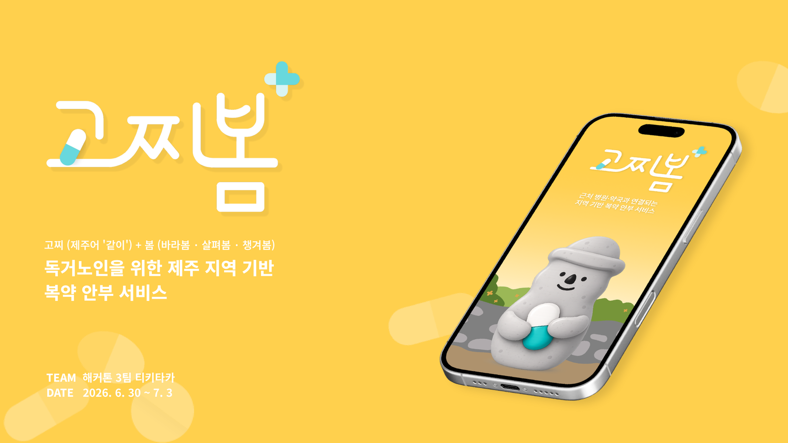
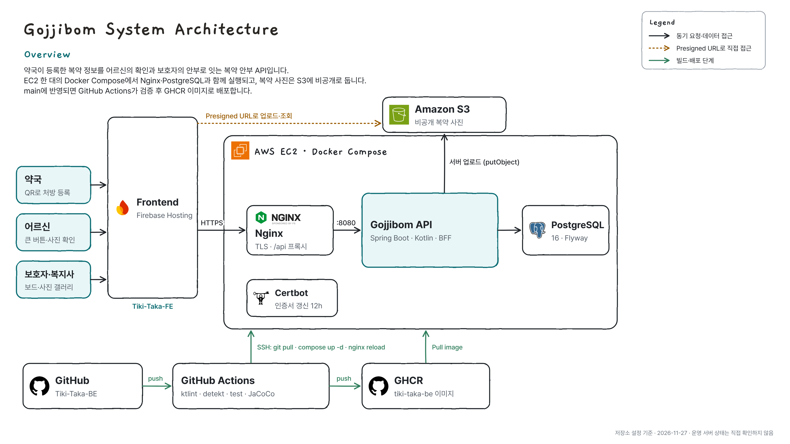
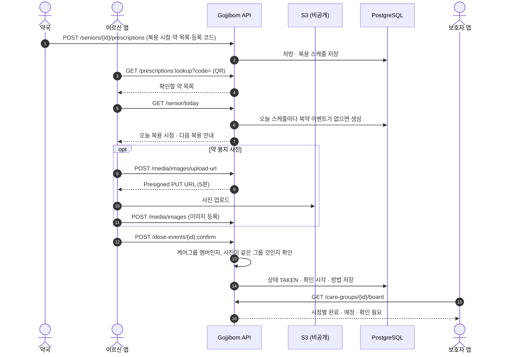
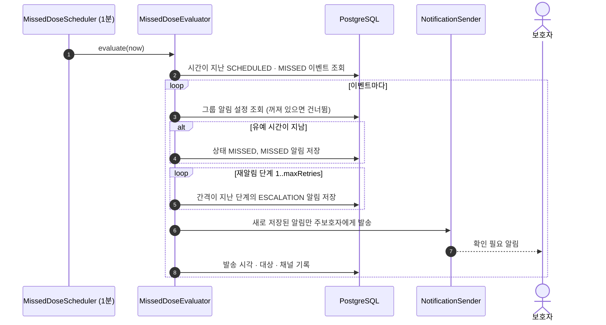
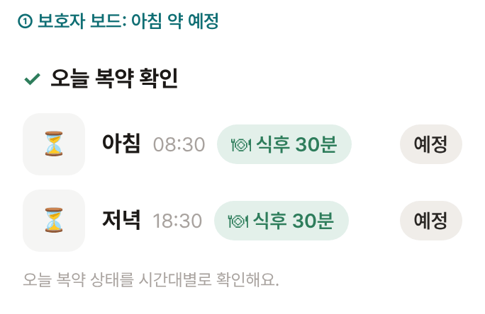
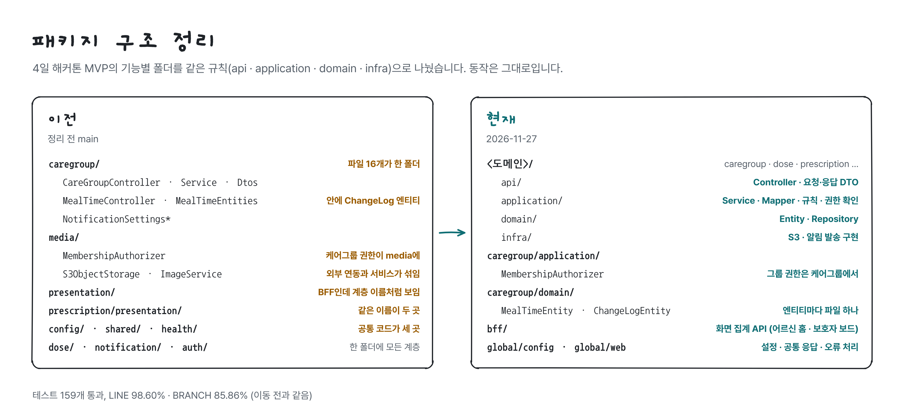
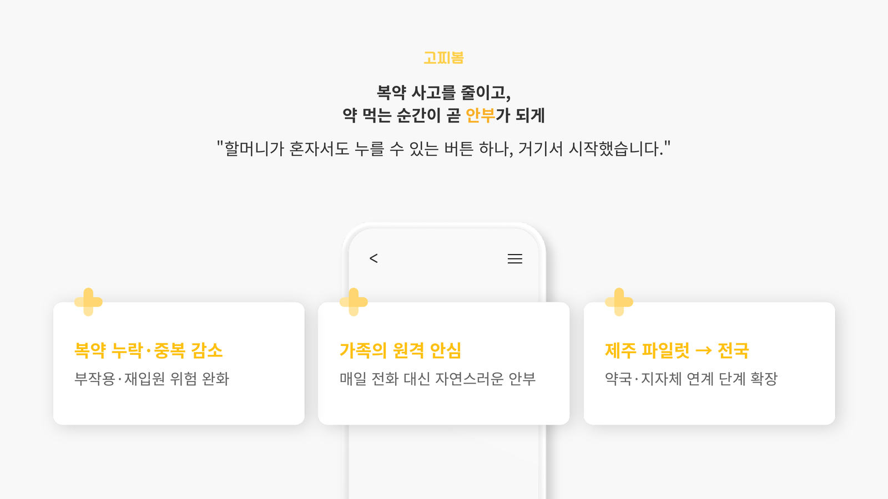

<div align="center">

# 고찌봄 Backend

약을 먹는 순간이 곧 안부가 되는 복약 안부 API



</div>

> 제주 지역 독거 어르신을 위한 복약 안부 서비스의 백엔드입니다. 약국이 등록한 처방을 어르신의 복약 확인으로, 다시 보호자의 안부 확인으로 연결합니다.

| 항목 | 내용 |
| :-- | :-- |
| 팀·기간 | 5인 팀, 4일 MVP (2026.06.30–07.03 해커톤) |
| 역할 | PM·개발 리드. 제품 우선순위, FE/BE 계약, 백엔드 설계·DB/API·배포 |
| 결과 | Spring Boot API, PostgreSQL·Flyway, GitHub Actions → GHCR → EC2 배포, TLS. 테스트 159개, LINE 98.60% |
| Live Demo | https://gojjibom.web.app/ |
| Frontend | [Tiki-Taka-FE](https://github.com/TIKI-TAKA-hackathon/Tiki-Taka-FE) |

## 전체 구조



FE는 Firebase Hosting에서 내려가고, API 요청은 EC2의 Nginx를 거쳐 Spring Boot로 들어옵니다. 복약 사진은 비공개 S3 버킷에 두고, 앱은 API가 발급한 Presigned URL로 직접 올리고 봅니다. 근거와 확인 범위는 [아키텍처 문서](./architecture/architecture.md), 표 구조는 [ERD](./docs/ERD.md)에 있습니다.

| 도메인 | 맡은 일 |
| :-- | :-- |
| `caregroup` | 어르신·보호자·복지사를 한 그룹으로 연결, 초대 링크, 주보호자, 식사 시간, 알림 설정, 변경 이력 |
| `prescription` | 약국의 처방 등록, 복용 시점별 스케줄, QR 등록 코드 조회 |
| `dose` | 날짜별 복약 이벤트 생성, 복약 확인, 사진 검토 |
| `notification` | 미복약 판정, 보호자 재알림 단계, 발송 기록 |
| `media` | 사진 업로드·조회용 Presigned URL, 이미지 등록 |
| `bff` | 어르신 홈, 보호자 보드, 사진 갤러리처럼 화면 하나에 필요한 데이터를 한 번에 조립 |

## 복약 확인 흐름



이미 `TAKEN`인 이벤트에 다시 확인 요청이 오면 그대로 돌려줍니다. 사진 파일은 API 서버를 거치지 않고, API는 객체 키가 케어그룹 경로(`images/{careGroupId}/`) 안에 있는지만 확인합니다.

## 미복약 알림 흐름



같은 이벤트·종류·단계의 알림은 한 번만 만들어집니다. 저장 전에 존재 여부를 보고, 동시에 두 번 실행되면 `UNIQUE` 제약이 두 번째 저장을 막습니다. 발송은 처음 저장한 실행에서만 합니다. 기본 발송 구현은 로그만 남기는 stub입니다.

## 핵심 코드

### 1. 복약 확인

[`dose/application/DoseService.kt`](./src/main/kotlin/xyz/stdiodh/gojjibom/dose/application/DoseService.kt#L65-L93)

```kotlin
requireActiveMember(careGroupId, request.actorUserId)

if (event.status == DoseEventStatus.TAKEN) {
    return mapper.toResponse(event)
}

request.imageId?.let { imageId ->
    imageService.assertDoseEventImage(imageId, event.requiredId(), careGroupId)
    event.photoImageId = imageId
    event.photoReviewStatus = PhotoReviewStatus.PENDING
}
```

그룹 멤버만 확인할 수 있고, 이미 확인한 이벤트는 바꾸지 않습니다. 사진을 붙이면 그 사진이 이 이벤트와 같은 케어그룹 것인지 확인한 뒤 보호자 검토 대기 상태로 둡니다.

### 2. 알림 중복 방지

[`notification/application/MissedDoseEvaluator.kt`](./src/main/kotlin/xyz/stdiodh/gojjibom/notification/application/MissedDoseEvaluator.kt#L129-L160)

```kotlin
if (notifications.existsByDoseEventIdAndTypeAndLevel(doseEventId, type, level)) {
    return null
}
val saved =
    try {
        notifications.save(NotificationEntity(/* ... */))
    } catch (_: DataIntegrityViolationException) {
        null
    }
saved?.let { dispatchToCaregiver(careGroupId, it) }
```

스케줄러가 1분마다 돌아도 같은 단계의 알림은 한 번만 저장되고 한 번만 발송됩니다.

### 3. 복약 이벤트를 조회 시점에 생성

[`dose/application/DoseEventGenerator.kt`](./src/main/kotlin/xyz/stdiodh/gojjibom/dose/application/DoseEventGenerator.kt#L22-L62)

날짜별 이벤트를 미리 배치로 만들지 않고, 어르신 홈이나 보호자 보드를 처음 열 때 그날 스케줄에 맞춰 만듭니다. 두 화면이 동시에 열려도 `(dose_schedule_id, scheduled_date)` 유니크 인덱스가 중복을 막고, 충돌하면 이미 만들어진 이벤트를 다시 읽습니다.

### 4. 주보호자를 잃지 않게 하기

[`caregroup/application/CareGroupService.kt`](./src/main/kotlin/xyz/stdiodh/gojjibom/caregroup/application/CareGroupService.kt#L368-L396)

주보호자가 그룹에서 빠지면 가장 먼저 합류한 활성 OWNER에게 주보호자를 넘기고 변경 이력에 남깁니다. 주보호자를 뺀 뒤 그룹 설정 변경이 모두 403으로 막히던 문제를 회귀 테스트로 먼저 재현하고 고친 코드입니다.

## 화면



로컬 PostgreSQL 컨테이너와 API에 처방을 등록하고, FE를 같은 API에 연결해 찍었습니다. 보호자 보드에서 아침 약이 `예정`이었다가 `POST /dose-events/1:confirm` 뒤 다시 조회하면 `완료`로 바뀝니다. 전체 사용 흐름과 시연 영상은 [Frontend 저장소](https://github.com/TIKI-TAKA-hackathon/Tiki-Taka-FE)에 있습니다.

## 패키지 구조 정리



해커톤 동안 기능마다 폴더 하나에 controller, service, entity, repository를 모두 넣었습니다. 2026-11-27에 도메인마다 `api`(요청·응답), `application`(업무 규칙), `domain`(엔티티·저장소), `infra`(S3·알림 발송 구현)로 나눴습니다. 다른 기능 폴더에 있던 권한 확인 클래스를 제자리로 옮기고, 이름과 내용이 다른 파일을 나눴습니다. 테스트 수와 커버리지는 이동 전후가 같습니다. 이동 내용과 남은 의존은 [패키지 구조 정리](./docs/refactoring/2026-11-package-structure.md)에 있습니다.

## API

도메인 API(`/api/v1/**`)는 `{ "data": ..., "error": ... }` 형태로 응답합니다. 전체 계약은 실행 중인 서버의 [Swagger UI](http://localhost:8080/swagger-ui/index.html)에 있습니다.

| 흐름 | Method | Endpoint | 상태 |
| :-- | :-- | :-- | :-- |
| OTP 데모 인증 | POST | `/api/v1/auth/otp:request`, `/api/v1/auth/otp:verify` | 데모 stub |
| 케어그룹 생성 | POST | `/api/v1/care-groups` | 구현 |
| 처방 등록 | POST | `/api/v1/seniors/{seniorId}/prescriptions` | 구현 |
| QR 처방 조회 | GET | `/api/v1/prescriptions:lookup?code=` | 구현 |
| 복약 확인 | POST | `/api/v1/dose-events/{id}:confirm` | 구현 |
| 어르신 홈 | GET | `/api/v1/senior/today?seniorId=` | 구현 |
| 보호자 보드 | GET | `/api/v1/care-groups/{id}/board` | 구현 |

## 테스트

```bash
./gradlew clean ktlintCheck detekt test jacocoTestReport jacocoTestCoverageVerification build
```

| 항목 | 값 (2026-11-27) |
| :-- | :-- |
| 테스트 | 159 passed, 0 failed |
| LINE | 2,330 / 2,363 (98.60%) |
| BRANCH | 504 / 587 (85.86%) |
| JaCoCo 게이트 | LINE 0.95, BRANCH 0.65 |

통합 테스트는 Testcontainers PostgreSQL로 Flyway 마이그레이션까지 실행합니다. PR에서는 lint, 정적 분석, 테스트, 커버리지 게이트, build를 검증하고, `main` 검증이 끝난 뒤에만 GHCR 이미지를 게시하고 EC2에 배포합니다. 범위와 남은 위험은 [테스트 문서](./docs/TESTING.md)에 있습니다.

## 실행

```bash
cp .env.example .env
POSTGRES_DB=gojjibom POSTGRES_USER=gojjibom POSTGRES_PASSWORD=gojjibom docker compose up -d postgres
./gradlew bootRun
curl http://localhost:8080/api/health
```

DB, CORS, 알림, S3 설정은 `.env.example`을 기준으로 합니다.

## MVP 범위 밖

| 항목 | 현재 상태 |
| :-- | :-- |
| 의료 판단 | 약을 추천하거나 바꾸지 않고, 사진을 복용 증거로 단정하지 않음. 미확인은 "확인 필요"로 표시 |
| 인증 | OTP는 SMS를 보내지 않는 데모 stub. JWT·세션은 후속 과제 |
| 접근 통제 | 일부 변경 API만 `actorUserId`와 멤버십을 대조. QR 조회와 BFF 조회는 운영 전 인증 주체 기반 인가가 필요 |
| 외부 알림 | 기본 발송은 로그만 남기는 stub. 카카오 알림톡·SMS 연동은 후속 과제 |

<details>
<summary>한계와 기대 효과 그림</summary>

<p align="center">
  
  
</p>

</details>

## 기술 스택

| 영역 | 기술 |
| :-- | :-- |
| Language·Framework | Kotlin 2.3.20, Java 21, Spring Boot 4.1.0 |
| Database | PostgreSQL 16, Spring Data JPA, Flyway |
| Media | AWS S3 호환 스토리지, Presigned URL |
| Infra | Docker Compose, Nginx, Certbot(Let's Encrypt), GitHub Actions, GHCR, EC2 |
| Quality | ktlint, detekt, JUnit, Testcontainers, JaCoCo |
| API Docs | springdoc-openapi |

## 문서

* [아키텍처와 근거](./architecture/architecture.md)
* [ERD](./docs/ERD.md)
* [테스트와 커버리지](./docs/TESTING.md)
* [패키지 구조 정리](./docs/refactoring/2026-11-package-structure.md)
* [FE·BE 계약 정렬](./docs/FE_BE_CONTRACT.md)
