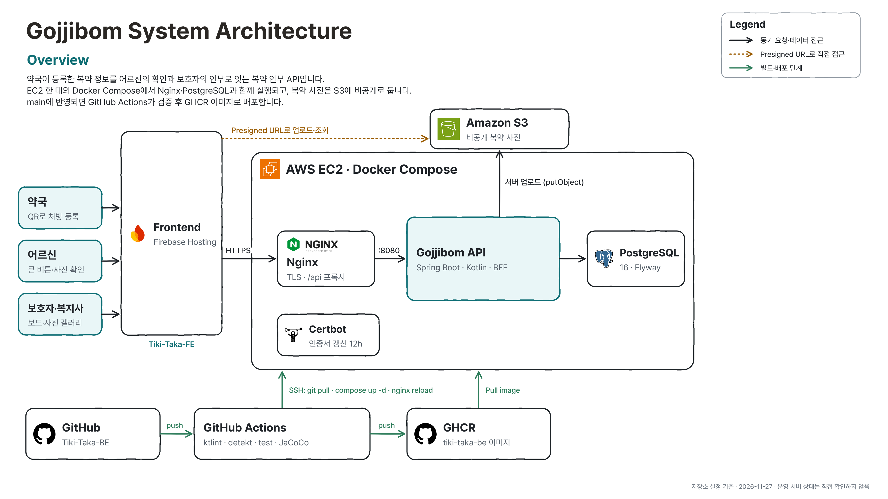

# 고찌봄 아키텍처

[SVG 원본](./architecture.svg)

## 구조 요약

- 약국이 등록한 복약 정보를 어르신·보호자에게 잇는 Spring Boot(Kotlin) API 하나입니다.
- 운영 배포 설정은 EC2 한 대의 Docker Compose로 Nginx, Certbot, API, PostgreSQL 컨테이너를 띄웁니다. 스키마는 Flyway로 관리합니다.
- 복약 사진은 Amazon S3에 비공개로 두고, API가 발급한 Presigned URL로 클라이언트가 직접 올리고 봅니다.
- `main`에 반영되면 GitHub Actions가 ktlint·detekt·테스트·JaCoCo를 통과시킨 뒤 GHCR에 이미지를 올리고, SSH로 EC2에서 갱신합니다.

## 조사 기준

| 항목 | 값 |
| --- | --- |
| 분석일 | 2026-11-26 |
| 저장소 | [TIKI-TAKA-hackathon/Tiki-Taka-BE](https://github.com/TIKI-TAKA-hackathon/Tiki-Taka-BE) |
| 확인한 브랜치 | 분석일 시점 `main` |
| 대상 환경 | `deploy.yml`이 배포하는 운영 구성 (저장소 설정 기준) |
| 경로 변경 | 2026-11-27 패키지 정리로 코드 경로가 바뀌었습니다. 아래 근거 링크는 분석 시점 커밋 기준이고, 현재 경로는 [패키지 구조 정리](../docs/refactoring/2026-11-package-structure.md)에 있습니다. |
| 운영 서버 | 직접 확인하지 않음 |

## 근거표

| 도면의 구성요소·연결·경계 | 의미 | 근거 | 환경 | 확인 상태 |
| --- | --- | --- | --- | --- |
| AWS EC2 · Docker Compose | 배포 대상 호스트와 컨테이너 묶음 | [deploy.yml](https://github.com/TIKI-TAKA-hackathon/Tiki-Taka-BE/blob/bb2823a2c73ab72b15bda16382410ddba119ff56/.github/workflows/deploy.yml) (`EC2_HOST`로 SSH), [docker-compose.yml](https://github.com/TIKI-TAKA-hackathon/Tiki-Taka-BE/blob/bb2823a2c73ab72b15bda16382410ddba119ff56/docker-compose.yml), [docker-compose.prod.yml](https://github.com/TIKI-TAKA-hackathon/Tiki-Taka-BE/blob/bb2823a2c73ab72b15bda16382410ddba119ff56/docker-compose.prod.yml) | 운영 | 코드·설정 확인 |
| Nginx | TLS 종료, `/api/`·Swagger 경로를 API로 프록시 | [nginx/conf.d/api.conf](https://github.com/TIKI-TAKA-hackathon/Tiki-Taka-BE/blob/bb2823a2c73ab72b15bda16382410ddba119ff56/nginx/conf.d/api.conf), [docker-compose.yml](https://github.com/TIKI-TAKA-hackathon/Tiki-Taka-BE/blob/bb2823a2c73ab72b15bda16382410ddba119ff56/docker-compose.yml) | 운영 | 코드·설정 확인 |
| Certbot | 인증서 12시간 주기 갱신 | [docker-compose.yml](https://github.com/TIKI-TAKA-hackathon/Tiki-Taka-BE/blob/bb2823a2c73ab72b15bda16382410ddba119ff56/docker-compose.yml) | 운영 | 코드·설정 확인 |
| Gojjibom API | Spring Boot · Kotlin, BFF 엔드포인트와 미복약 판정 스케줄러 포함 | [build.gradle.kts](https://github.com/TIKI-TAKA-hackathon/Tiki-Taka-BE/blob/bb2823a2c73ab72b15bda16382410ddba119ff56/build.gradle.kts), [BffController.kt](https://github.com/TIKI-TAKA-hackathon/Tiki-Taka-BE/blob/bb2823a2c73ab72b15bda16382410ddba119ff56/src/main/kotlin/xyz/stdiodh/gojjibom/presentation/BffController.kt), [MissedDoseScheduler.kt](https://github.com/TIKI-TAKA-hackathon/Tiki-Taka-BE/blob/bb2823a2c73ab72b15bda16382410ddba119ff56/src/main/kotlin/xyz/stdiodh/gojjibom/notification/MissedDoseScheduler.kt) | 운영 | 코드·설정 확인 |
| API → PostgreSQL | JPA 저장소, Flyway 마이그레이션 | [application.yml](https://github.com/TIKI-TAKA-hackathon/Tiki-Taka-BE/blob/bb2823a2c73ab72b15bda16382410ddba119ff56/src/main/resources/application.yml), [db/migration](https://github.com/TIKI-TAKA-hackathon/Tiki-Taka-BE/blob/bb2823a2c73ab72b15bda16382410ddba119ff56/src/main/resources/db/migration), [docker-compose.yml](https://github.com/TIKI-TAKA-hackathon/Tiki-Taka-BE/blob/bb2823a2c73ab72b15bda16382410ddba119ff56/docker-compose.yml) | 운영 | 코드·설정 확인 |
| API → Amazon S3 | 서버 측 `putObject` 업로드 | [S3ObjectStorage.kt](https://github.com/TIKI-TAKA-hackathon/Tiki-Taka-BE/blob/bb2823a2c73ab72b15bda16382410ddba119ff56/src/main/kotlin/xyz/stdiodh/gojjibom/media/S3ObjectStorage.kt), [MediaConfig.kt](https://github.com/TIKI-TAKA-hackathon/Tiki-Taka-BE/blob/bb2823a2c73ab72b15bda16382410ddba119ff56/src/main/kotlin/xyz/stdiodh/gojjibom/media/MediaConfig.kt) | 운영 | 코드·설정 확인 |
| Client → Amazon S3 (Presigned) | API가 발급한 URL로 사진 업로드·조회 | [ImageService.kt](https://github.com/TIKI-TAKA-hackathon/Tiki-Taka-BE/blob/bb2823a2c73ab72b15bda16382410ddba119ff56/src/main/kotlin/xyz/stdiodh/gojjibom/media/ImageService.kt) (`createUploadUrl`, `createViewUrl`) | 운영 | 코드·설정 확인 (FE 저장소는 열람하지 않음) |
| Frontend (Firebase Hosting) | `gojjibom.web.app`에 배포된 화면 | [README 링크 표](https://github.com/TIKI-TAKA-hackathon/Tiki-Taka-BE/blob/bb2823a2c73ab72b15bda16382410ddba119ff56/README.md) | 운영 | 사용자 문서 확인 |
| GitHub Actions → GHCR | 검증 후 이미지 build·push | [deploy.yml](https://github.com/TIKI-TAKA-hackathon/Tiki-Taka-BE/blob/bb2823a2c73ab72b15bda16382410ddba119ff56/.github/workflows/deploy.yml) (`verify`, `build-and-push`) | CI/CD | 코드·설정 확인 |
| Actions → EC2 (SSH), GHCR → EC2 (Pull) | `git pull`, `compose pull`·`up -d`, Nginx reload | [deploy.yml](https://github.com/TIKI-TAKA-hackathon/Tiki-Taka-BE/blob/bb2823a2c73ab72b15bda16382410ddba119ff56/.github/workflows/deploy.yml) (`deploy`) | CI/CD | 코드·설정 확인 |

## 로고 출처

| 기술·제품 | 사용 파일 | 공식 출처 | 확인일 |
| --- | --- | --- | --- |
| Amazon EC2 | `assets/logos/aws-ec2.svg` | [aws.amazon.com/architecture/icons](https://aws.amazon.com/architecture/icons/) | 2026-11-26 |
| Firebase | `assets/logos/firebase.svg` | [firebase.google.com/brand-guidelines](https://firebase.google.com/brand-guidelines) | 2026-11-26 |
| NGINX | `assets/logos/nginx.svg` | [nginx.org](https://nginx.org/) | 2026-11-26 |
| Certbot | `assets/logos/certbot.svg` | [certbot.eff.org](https://certbot.eff.org/) | 2026-11-26 |
| PostgreSQL | `assets/logos/postgresql.svg` | [wiki.postgresql.org/wiki/Logo](https://wiki.postgresql.org/wiki/Logo) | 2026-11-26 |
| Amazon Simple Storage Service | `assets/logos/aws-s3.svg` | [aws.amazon.com/architecture/icons](https://aws.amazon.com/architecture/icons/) | 2026-11-26 |
| GitHub | `assets/logos/github.svg` | [brand.github.com/foundations/logo](https://brand.github.com/foundations/logo) | 2026-11-26 |

## 확인 필요 사항

- 알림 발송은 `stub` 구현만 있어 외부 알림 서비스는 도면에서 뺐습니다.
- Firebase Hosting은 README의 Live Demo 주소 기준이며 FE 저장소의 배포 설정은 열람하지 않았습니다.
