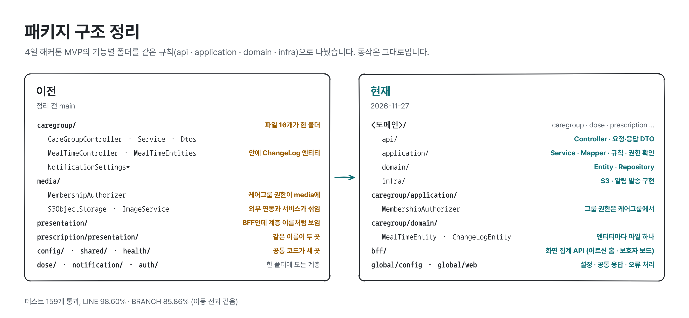

# 패키지 구조 정리

4일 해커톤에서 기능마다 폴더 하나를 두고 controller, service, entity, repository를 모두 넣었습니다. 기능이 늘면서 한 폴더에 성격이 다른 파일이 섞였고, 몇몇 클래스는 다른 기능의 폴더에 들어가 있었습니다. 2026-11-27에 동작을 바꾸지 않고 같은 규칙으로 나눴습니다.

## 이전 구조의 문제

| 문제 | 위치 | 영향 |
| --- | --- | --- |
| 한 폴더에 모든 계층 | `caregroup/` 16개 파일, `notification/` 13개 파일 | 컨트롤러를 찾으려면 엔티티·저장소 파일 사이를 훑어야 함 |
| 파일 이름과 내용이 다름 | `caregroup/MealTimeEntities.kt` 안에 `ChangeLogEntity`, `MealTimeRepositories.kt` 안에 `ChangeLogRepository` | 변경 이력 엔티티를 파일 이름으로 찾을 수 없음 |
| 다른 기능의 클래스가 섞임 | `media/MembershipAuthorizer.kt` (케어그룹 멤버 확인) | 사진 기능이 케어그룹 권한 규칙을 가진 것처럼 보임 |
| 외부 연동과 서비스가 같은 폴더 | `media/S3ObjectStorage.kt`, `notification/StubNotificationSender.kt` | 교체 가능한 구현과 업무 규칙의 경계가 보이지 않음 |
| 이름이 역할을 숨김 | `presentation/`(BFF 화면 집계 API), `prescription/presentation/` | 계층 이름처럼 읽히고, 같은 이름이 두 곳에 있음 |
| 공통 코드가 흩어짐 | `config/`, `shared/`, `health/` | 공통 응답·오류 처리·설정을 세 곳에서 찾아야 함 |

## 바꾼 규칙

각 도메인 폴더 아래를 네 개로 나눴습니다.

| 하위 패키지 | 들어가는 것 |
| --- | --- |
| `api` | Controller, 요청·응답 DTO |
| `application` | Service, Mapper, 업무 규칙(`*Rules`), 오류 코드(`*Errors`), 권한 확인, 외부 연동 인터페이스 |
| `domain` | Entity, enum, Repository, `requiredId()` 확장 함수 |
| `infra` | 외부 연동 구현 (S3, 알림 발송), 해당 설정 |

## 이동 내용

| 이전 | 현재 | 비고 |
| --- | --- | --- |
| `caregroup/*Controller`, `*Dtos` | `caregroup/api/` | 식사 시간·알림 설정 컨트롤러 포함 |
| `caregroup/CareGroupService`, `Mapper`, `Rules`, `Errors` | `caregroup/application/` | |
| `media/MembershipAuthorizer` | `caregroup/application/` | 같은 403 응답을 만드는 `CareGroupErrors.forbidden` 사용 |
| `caregroup/MealTimeEntities.kt` | `caregroup/domain/MealTimeEntity.kt`, `ChangeLogEntity.kt` | 한 파일을 엔티티별로 분리 |
| `caregroup/MealTimeRepositories.kt` | `caregroup/domain/MealTimeRepository.kt`, `ChangeLogRepository.kt` | 한 파일을 저장소별로 분리 |
| `media/S3ObjectStorage`, `MediaConfig` | `media/infra/` | `ObjectStorage` 인터페이스는 `media/application/` |
| `notification/StubNotificationSender` | `notification/infra/` | `NotificationSender` 인터페이스는 `notification/application/` |
| `presentation/` | `bff/api/`, `bff/application/` | `PresentationDtos.kt` 파일 이름은 `BffDtos.kt`로 |
| `prescription/presentation/` | `prescription/application/` | QR 확인 화면·처방 이력 조립 |
| `config/`, `shared/ClockConfig` | `global/config/` | |
| `shared/ApiResponse`, `ApiException`, `ErrorHandler`, `health/` | `global/web/` | |
| `auth`, `dose`, `notification`, `prescription`의 나머지 | 각 도메인의 `api`, `application`, `domain` | |

클래스 이름과 API 경로는 바꾸지 않았습니다. JPQL 안에 적힌 `DoseEventStatus` 전체 이름은 새 패키지로 고쳤습니다.

단위 테스트는 대상 클래스와 같은 패키지로 옮겼고, 통합 테스트는 도메인 폴더(`caregroup/`, `dose/` 등)에 그대로 두었습니다.

## 확인한 것

| 항목 | 이전 | 현재 |
| --- | --- | --- |
| 테스트 | 159 passed | 159 passed |
| LINE | 2,330 / 2,363 (98.60%) | 2,330 / 2,363 (98.60%) |
| BRANCH | 504 / 587 (85.86%) | 504 / 587 (85.86%) |
| `ktlintCheck`, `detekt`, `jacocoTestCoverageVerification`, `build` | 통과 | 통과 |

명령: `./gradlew clean ktlintCheck detekt test jacocoTestReport jacocoTestCoverageVerification build`

## 남은 의존

| 의존 | 이유 |
| --- | --- |
| `notification` → `bff.application.PresentationFormat` | 미복약 알림 본문에 화면과 같은 복용 시점 문구(`slotLabel`)를 씀. 문구 포맷을 옮기면 화면 문구와 알림 문구가 갈라질 수 있어 그대로 둠 |
| `dose` → `media.application.ImageService` | 복약 확인 때 사진이 같은 케어그룹 것인지 확인 |
